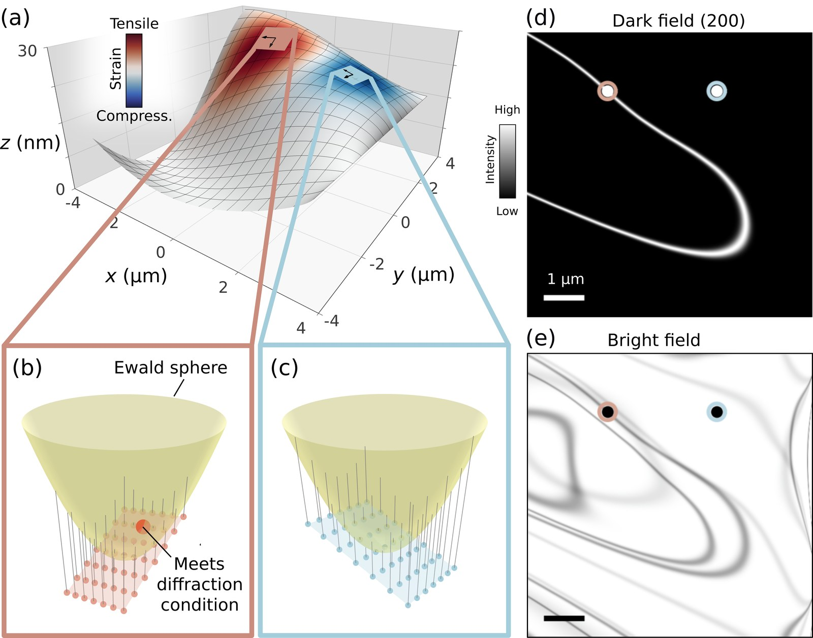
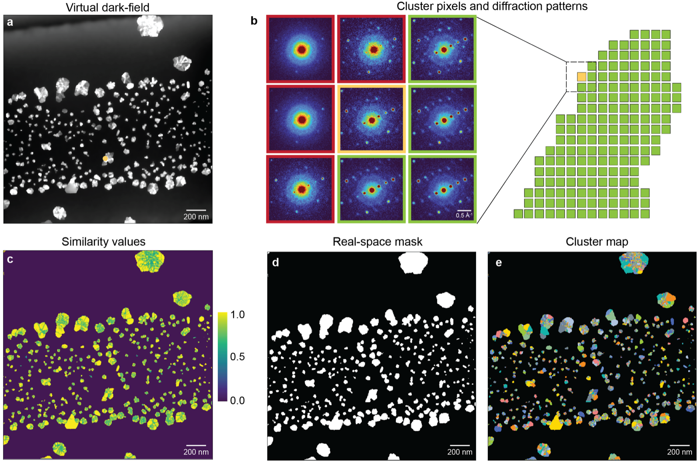

:::{anywidget} ./widgets/section-nav.js
{}
:::

We develop new STEM measurements using advanced detectors, beam shaping, and programmable acquisition. We record and invert massive electron-scattering datasets to reveal structural, chemical, and other signals beyond conventional imaging.

## Nanobeam 4D-STEM of Ordered Materials

:::{figure} /images/research/research_ordered_acom.png
:alt: Nanobeam 4D-STEM phase mapping of a hafnia film.
Nanobeam 4D-STEM maps crystalline phases in a hafnia (HZO) film, indexing the diffraction pattern at every probe position.
:::

Crystalline materials diffract electrons into sharp Bragg peaks that encode local orientation, phase, and strain. Nanobeam 4D-STEM indexes a full diffraction pattern at every probe position, [mapping orientation and phase](doi.org/10.1017/S1431927622000101) across grains, domains, twins, and interfaces, and [measuring strain](doi.org/10.1016/j.ultramic.2016.12.021) in heterogeneous polycrystalline samples with nanometer resolution.

## Nanobeam 4D-STEM of Disordered Materials

::::{div}

<video src="/videos/atomic_struct_04_crop.mp4" autoplay loop muted playsinline style="width: 100%; border-radius: 4px;"></video>
A model atomic structure with short- and medium-range order.

Nanobeam diffraction reveals short- and medium-range order in materials that are neither fully crystalline nor fully amorphous. The [`tricor` framework](https://tricor.readthedocs.io/en/latest/) generates disordered atomic models from three-body correlations, enabling direct comparison between simulated structures and experimental diffraction.
::::

## Nanobeam Diffraction and Machine Learning for Polymer Order

:::{figure} /images/research/research_polymer_flowlines.png
:alt: Machine-learning orientation flowlines in a semicrystalline polymer.
Machine-learning orientation flowlines mapping lamellar, backbone, and π-π order in a semicrystalline polymer.
:::

Low-dose nanobeam electron diffraction combined with [machine learning maps semicrystalline order](https://arxiv.org/abs/2607.16570) in polymer materials. A neural network trained on simulated diffraction detects lamellar, backbone, and π-π peaks in noisy experimental patterns, and the resulting flowline maps quantify orientation, morphology, and local ordering across heterogeneous polymer microstructures.

## Topography and Strain Mapping of 2D Membranes

::::{div}

A bent, strained film satisfies the Bragg condition only along curved bend contours, which encode its surface normal and lattice strain.

Rippled and suspended membranes require strain analysis on the actual curved surface, not on a flat projection. Nanobeam 4D-STEM measurements [reconstruct both out-of-plane topography and in-plane strain](doi.org/10.1126/sciadv.adz7908), enabling quantitative maps of deformed two-dimensional materials. [Bend contour electron tomography](doi.org/10.1103/pmcz-g3l8) recovers the same quantities from a series of conventional bright-field images: the bend contours that appear as a freestanding film tilts are fit with a forward model to reconstruct its full 3D topography and strain field.
::::

## In Situ 4D-STEM and 5D-STEM

:::{figure} /images/research/research_5dstem_growth.jpg
:alt: In-plane crystal orientation maps of Au nanocrystals growing in a liquid cell over 270 seconds.
5D-STEM orientation maps of Au nanocrystals growing in a liquid cell, from nucleation to coalescence over 270 seconds.
:::

::::{div}

Unsupervised clustering segments an in situ 4D-STEM dataset of nanoparticle growth.

Scanning diffraction can track structural changes during dynamic experiments, but in situ 4D-STEM datasets are often too large and complex to analyze manually. [Unsupervised clustering of diffraction-pattern similarity](https://arxiv.org/abs/2601.17262) segments coherent structural regions, compresses massive datasets, and [quantifies liquid-cell growth pathways](doi.org/10.1093/mam/ozag044). Continuous acquisition extends this into [5D-STEM of nanocrystal growth](https://arxiv.org/abs/2609.25549), which resolves morphology, crystal orientation, and lattice strain of every particle during growth, connecting ensemble kinetics to particle-level pathways such as continuous growth and coalescence by oriented attachment.
::::

## 4D-STEM of CO₂ Capture and Utilization in Metal-Organic Frameworks

4D-STEM provides a direct view of structural heterogeneity in metal-organic frameworks designed for integrated CO₂ capture and conversion. This project connects local framework order, pore-scale structure, and reaction-driven changes to capture and utilization performance.
